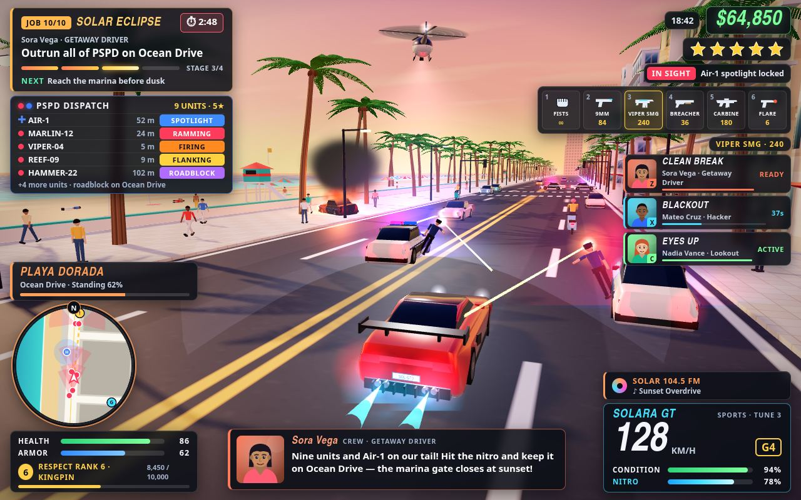

# PALMA SOL: Neon Coast

[](https://make.fun/c/gta6-01?ref=52vz5va8)
[](https://make.fun/c/gta6-01?ref=52vz5va8)
[](https://make.fun/c/gta6-01?ref=52vz5va8)

An original open-world crime game for the browser, built with Three.js and nothing else: a sun-bleached
coastal city of Art Deco hotels, palm-lined boulevards, a neon night market and a turquoise ocean. Steal
cars, outrun the Palma Sol Police Department and their Air-1 helicopter, tune your Solara GT at Chrome &
Torque Customs, and work through a ten-job story with a three-person crew.

Built for the make.fun bounty **[gta6-01](https://make.fun/bounty/gta6-01)**.



## Features

- **Six districts:** Playa Dorada, Neon Mercado, Porto Viejo, Palmera Hills, Solar Centro and Coral Heights, generated from a seed with merged geometry, canvas-painted facades, neon signs, traffic and beachgoers.
- **Arcade driving:** nitro, handbrake drifts and damage. You can carjack any car on the road.
- **PSPD wanted system (0–5 stars):** cruisers run RAMMING, FIRING, FLANKING, PURSUIT and ROADBLOCK tactics. Air-1 keeps a spotlight on you, and the stars only drain once units lose line of sight.
- **Gunplay on foot:** six weapons (fists, 9mm, Viper SMG, Breacher shotgun, carbine and flare launcher) with tracers and muzzle flashes.
- **Crew abilities:** Sora Vega's CLEAN BREAK drops a star, Mateo Cruz's BLACKOUT kills police radios, and Nadia Vance's EYES UP marks every unit.
- **Ten-job campaign:** each job has gold or silver ratings, respect ranks from NOBODY to LEGEND OF PALMA, and district standing.
- **Chrome & Torque Customs:** a turntable showroom selling engine, armor, tires, nitro and weapons.
- **Map and pause screen:** story progress, career stats and three local save slots.
- **Synthesised audio:** engine, sirens, gunfire and three procedurally sequenced radio stations. There are no audio files.

## Run

```sh
node serve.ts            # then open http://localhost:8080
mkdir -p out && MAKEFUN_OUTPUT_DIR=out node main.ts   # build the entry
```

The game is static files under `game/` (ES modules with a vendored `three.module.min.js`), and it makes no network requests.

## Controls

| Key | Action |
| --- | --- |
| WASD / Arrows | Drive or walk |
| Space | Handbrake |
| Shift | Nitro / sprint |
| F | Enter or steal a car |
| Click | Shoot |
| 1–6 | Weapons |
| Z / X / C | Crew abilities |
| G | Garage |
| M | Map / pause |
| R | Next radio station |
| Esc | Back / pause |

Add `?autostart=1` to skip the title screen. `?shot=chase|shootout|garage|map&seed=1` renders the deterministic screenshot scenes.

## Referral

New to make.fun? Join with referral code `52vz5va8`.
